<!-- The cards below are generated by scripts/cards/build.py and refreshed daily by the workflow. -->

<a href="https://www.akshaymaurya.com"><picture><source media="(prefers-color-scheme: dark)" srcset="assets/cards/hero-dark.svg"></picture></a>

<a href="https://www.akshaymaurya.com"><picture><source media="(prefers-color-scheme: dark)" srcset="assets/cards/chip-portfolio-dark.svg"></picture></a><a href="https://www.linkedin.com/in/codenameakshay/"><picture><source media="(prefers-color-scheme: dark)" srcset="assets/cards/chip-linkedin-dark.svg"></picture></a><a href="https://x.com/codenameakshay"><picture><source media="(prefers-color-scheme: dark)" srcset="assets/cards/chip-x-dark.svg"></picture></a><a href="mailto:akshaymaurya3006@gmail.com"><picture><source media="(prefers-color-scheme: dark)" srcset="assets/cards/chip-email-dark.svg"></picture></a>

<a href="https://www.producthunt.com/products/one4wall"><picture><source media="(prefers-color-scheme: dark)" srcset="assets/cards/stat-1-dark.svg"></picture></a><a href="https://github.com/Hash-Studios/Prism"><picture><source media="(prefers-color-scheme: dark)" srcset="assets/cards/stat-2-dark.svg"></picture></a><a href="https://github.com/codenameakshay"><picture><source media="(prefers-color-scheme: dark)" srcset="assets/cards/stat-3-dark.svg"></picture></a><a href="https://pub.dev/publishers/hashstudios.dev/packages"><picture><source media="(prefers-color-scheme: dark)" srcset="assets/cards/stat-4-dark.svg"></picture></a>

## Products

<a href="https://deploy-hermes.com"><picture><source media="(prefers-color-scheme: dark)" srcset="assets/cards/product-hermes-dark.svg"></picture></a><a href="https://rentaikey.com"><picture><source media="(prefers-color-scheme: dark)" srcset="assets/cards/product-rentaikey-dark.svg"></picture></a><a href="https://github.com/Hash-Studios/Prism"><picture><source media="(prefers-color-scheme: dark)" srcset="assets/cards/product-prism-dark.svg">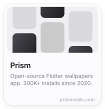</picture></a>

<a href="https://github.com/odinapp/odin"><picture><source media="(prefers-color-scheme: dark)" srcset="assets/cards/product-odin-dark.svg"></picture></a><a href="https://apps.apple.com/app/pokerface/id6477531089"><picture><source media="(prefers-color-scheme: dark)" srcset="assets/cards/product-pokerface-dark.svg"></picture></a><a href="https://hashstudios.in"><picture><source media="(prefers-color-scheme: dark)" srcset="assets/cards/product-hashstudios-dark.svg"></picture></a>

## Packages

<a href="https://pub.dev/packages/ai_sdk_dart"><picture><source media="(prefers-color-scheme: dark)" srcset="assets/cards/pkg-ai_sdk_dart-dark.svg"></picture></a><a href="https://pub.dev/packages/ai_sdk_flutter_ui"><picture><source media="(prefers-color-scheme: dark)" srcset="assets/cards/pkg-ai_sdk_flutter_ui-dark.svg"></picture></a><a href="https://pub.dev/packages/dart_tui"><picture><source media="(prefers-color-scheme: dark)" srcset="assets/cards/pkg-dart_tui-dark.svg">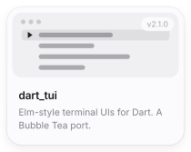</picture></a><a href="https://pub.dev/packages/dart_minify"><picture><source media="(prefers-color-scheme: dark)" srcset="assets/cards/pkg-dart_minify-dark.svg"></picture></a>

<a href="https://pub.dev/packages/beui"><picture><source media="(prefers-color-scheme: dark)" srcset="assets/cards/pkg-beui-dark.svg"></picture></a><a href="https://pub.dev/packages/flutter_floating_bottom_bar"><picture><source media="(prefers-color-scheme: dark)" srcset="assets/cards/pkg-flutter_floating_bottom_bar-dark.svg">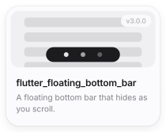</picture></a><a href="https://pub.dev/packages/async_wallpaper"><picture><source media="(prefers-color-scheme: dark)" srcset="assets/cards/pkg-async_wallpaper-dark.svg"></picture></a><a href="https://pub.dev/packages/secure_content"><picture><source media="(prefers-color-scheme: dark)" srcset="assets/cards/pkg-secure_content-dark.svg"></picture></a>

Plus 10 more ai_sdk_dart packages: the provider interface, an MCP client, and providers for OpenAI, Anthropic, Google, Azure, Ollama, Groq, Mistral and Cohere. All published under [hashstudios.dev](https://pub.dev/publishers/hashstudios.dev/packages).

## Experience

- **Stealth fintech startup** · 2026 – now. Building a Flutter app with a team of two.
- **[CRED](https://cred.club)** · SDE-1, Mobile · 2024 – 2026. Shipped Credit Score end to end and owned the Gift Cards frontend as it grew to India's #2 by GMV. My animations are on [60fps.design](https://60fps.design/apps/cred).
- **qoohoo / SuperKalam (YC W23)** · Product Engineer · 2022 – 2024. Built the qoohoo app from zero, then SuperKalam's web app and LLM pipelines.
- **[Hash Studios](https://hashstudios.in)** · Co-founder · 2020 – 2021. Took Prism from zero to 200K installs.

## Writing

<!-- BLOG-POST-LIST:START -->
- [“I Just Deleted Some Data in a Tunnel and It Still Synced” — Building an Offline-First Sync Engine…](https://codenameakshay.medium.com/i-just-deleted-some-data-in-a-tunnel-and-it-still-synced-building-an-offline-first-sync-engine-75ee0b49eced?source=rss-b46a5c18f171------2)
- [How to Level Up Your Dart Terminal Apps with dart_tui](https://levelup.gitconnected.com/how-to-level-up-your-dart-terminal-apps-with-dart-tui-3eb5a1a80790?source=rss-b46a5c18f171------2)
- [When I got tired of re-learning every provider’s streaming format](https://codenameakshay.medium.com/when-i-got-tired-of-re-learning-every-providers-streaming-format-f458ee64601b?source=rss-b46a5c18f171------2)
- [Flutter in a Blur: Shader Your Way to High-Performance UI Magic!](https://codenameakshay.medium.com/flutter-in-a-blur-shader-your-way-to-high-performance-ui-magic-703a5cafc0fb?source=rss-b46a5c18f171------2)
- [Let’s Get Real &lpar;Time&rpar;! Handling WebSockets in Flutter Like a Pro](https://codenameakshay.medium.com/lets-get-real-time-handling-websockets-in-flutter-like-a-pro-d1cdc3267a20?source=rss-b46a5c18f171------2)
<!-- BLOG-POST-LIST:END -->

## Stats

<picture><source media="(prefers-color-scheme: dark)" srcset="https://github-readme-stats.vercel.app/api?username=codenameakshay&show_icons=true&hide_border=true&border_radius=20&bg_color=18181c&title_color=f5f5f7&icon_color=f5f5f7&text_color=9a9aa3&ring_color=f5f5f7"></picture><picture><source media="(prefers-color-scheme: dark)" srcset="https://github-readme-stats.vercel.app/api/top-langs/?username=codenameakshay&layout=compact&hide_border=true&border_radius=20&bg_color=18181c&title_color=f5f5f7&text_color=9a9aa3"></picture>

<picture><source media="(prefers-color-scheme: dark)" srcset="https://streak-stats.demolab.com/?user=codenameakshay&hide_border=true&border_radius=20&background=18181c&ring=f5f5f7&fire=f5f5f7&currStreakNum=f5f5f7&sideNums=f5f5f7&currStreakLabel=f5f5f7&sideLabels=9a9aa3&dates=6e6e73"></picture>

